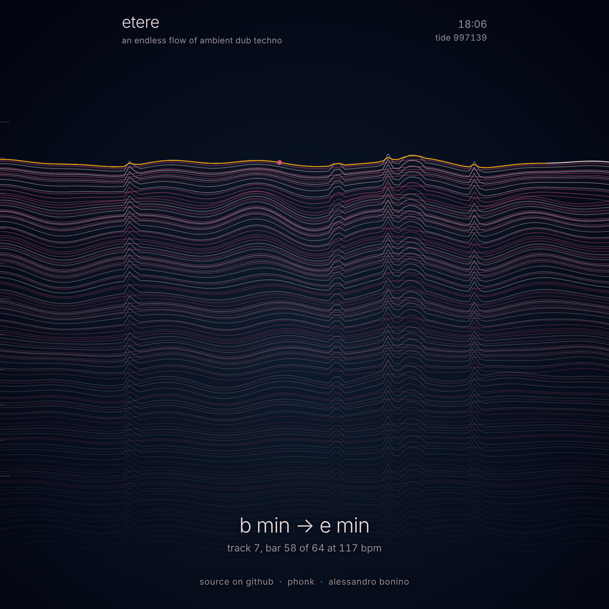

# etere

*an endless flow of ambient dub techno*

A radio with one programme. It is always on air, and whoever tunes in, anywhere, hears the same bar of the same track at the same moment. There is no stream and no server: everything is generated in real time, in your browser. One HTML file, no samples, no dependencies, no install.

**▶ Tune in: [phonk.github.io/etere](https://phonk.github.io/etere/)**

## Listen

Tap the page to tune in, tap again to tune out. There is nothing else to set.

The music is [marea](https://phonk.github.io/marea/): tides rise from slow ambient into dub techno and fall back. Here each tide lasts exactly half an hour of the clock, low at :00 and :30, high in between.

Top right is the station clock: the number of the tide on air and how far into it we are. It is the same on every screen, and it runs whether or not anyone is listening.

## How it stays the same for everyone

Every half hour of the world clock has a number, and that number is the seed of everything played in it: the tempo, the keys, the tracks, every pattern and every change. Nothing that decides what is played is left to chance.

When you tune in, the page works out which tide the clock says we are in, replays it silently from its beginning up to this moment, which takes an instant, and goes live from there. Two people listening are as close together as their clocks are, usually well under a second.

## What you see

The page is a tide gauge. The bright line is the water: it stands where the tide is, and its shape is the chord that is sounding, one ripple per voice. Everything the music does leaves a line behind at that level, and the lines sink and fade: kicks with their notches, dub chords in pink with their echoes, the high pings as grains of amber. The amber stretch of the water is how far the track has gone, and the dot riding it is the bar.

## Notes

- It keeps playing with the phone screen off.
- English interface. Made by [Alessandro Bonino](https://alessandrobonino.com/) with Claude.
